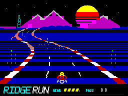

# Spectrum Attribute Racer

Two motorcycle circuits for the ZX Spectrum 128K. The camera follows the bike from behind. Steer to move the road under the tyres, watch for riders coming back into view over crests, and pass on either side. Contact or running wide drops the bike to first gear. Each clean overtake adds one to the dashboard counter.

| Circuit | Ride | Emulator capture |
| --- | --- | --- |
| [Coast Run](play/coast-run.tap) | Climb the headland past the beacons, drop into a hooked ravine, then cross the low causeway before the paired summit bends. | [Watch a lap](docs/coast-run.gif) |
| [Ridge Run](play/ridge-run.tap) | Follow the pines into a steep switchback climb. The road disappears over a blind summit, opens into a downhill S-bend and climbs a second ridge. | [Watch a lap](docs/ridge-run.gif) |



## Play

Open either TAP with tape autoload on a 128K Spectrum, +2 or +2A emulator. Enable mid-frame shadow-screen switching (Real Video in ZEsarUX). Both rides start in second gear.

| Keys | Action |
| --- | --- |
| O / P | Steer left / right. The bike leans near the centre and the foreground road shifts underneath it. |
| Q / A | Shift up / down through four gears |

## Build and test

Run these commands from the checkout with Python 3.10 or later. The build uses SjASMPlus. The headless tests use ZEsarUX. On the original Windows development machine both commands find the same installations as the shmup.

```powershell
python tools/build.py
python tools/verify.py
```

Both commands accept `--course coast` or `--course ridge`. The verifier also accepts `--model 128k`, `--model P2` or `--model P2A41`. Set `SJASMPLUS` and `ZESARUX` to the tool paths if needed, or pass `--assembler <path>` and `--emulator <path>` respectively. The build writes a TAP, an instant-start SNA and a symbol map for each circuit in `build/` (Coast Run) and `build/ridge/` (Ridge Run). On Windows, `Build-TAP.bat` also rebuilds both.

## How the road works

The starting point was the shmup's Ringo-8/Blokius renderer. An interrupt synchronises the frame, and scheduled writes to `#7FFD` let the ULA fetch colours from either screen. The racer has its own raster loop, course compiler and sprite compositor. [Shmup source and timing measurements](https://github.com/johnparker007/SpectrumAttributeShmup/blob/b9f0878/docs/timing-baseline.md)

* Each circuit has a closed elevation and curvature profile. The compiler projects 256 camera positions around the lap at quarter-station intervals. At each position a scanline takes the nearest visible ground. A crest can hide a valley, a sign or an approaching rider. A gentle angular compression at the edges of the field of view softens the reveal of distant switchbacks.
* The camera has its own lateral position. O and P move it across the road, and curvature pushes it outwards over successive quarter-steps. Each eight-line strip samples a 480-pixel-wide road at an offset proportional to its visible depth. The foreground moves the most. The 24×24 rider is composited from the underlying terrain every frame with neutral centre at x=124 on the 256-pixel display.
* The verge and asphalt share one background. Bright bands draw white kerbs and lane dashes on black. Normal-intensity bands draw red kerbs on blue, and the lane dashes blend into the blue. Each kerb follows the projected road edge on every scanline, tapering from 18 pixels at the tyres to about three in the distance. When the compiler fits a diagonal into its tile set, it gives extra weight to where the stripe enters and leaves the tile.
* The 50 Hz raster chooses a screen in the horizontal border before each of 128 scanlines. Between switches it compares 256 visible tiles from one half of the road with the requested view. It alternates halves each frame and resumes at the first unprocessed area when a large bend or a steering input changes many tiles. A fixed batch is drawn before the next road raster, with additional tiles drawn behind the beam when the course data is already current.
* Each quarter-step has two independently decodable sets of tile changes, scanline depths and steering scales. In second gear the road takes a new position every seven display frames. In fourth it alternates between three and four frames. Striping, steering input and rider lean update every display frame.

Edit the course profiles and projection in [tools/route.py](tools/route.py), scenery and tile conversion in [tools/course.py](tools/course.py), and the running game in [src/racer.asm](src/racer.asm).

## Timing checks

The verifier boots both release tapes through the ROM loader and checks the real-video image. A separate top-gear run compares the moving picture with the expected camera, rider, road and dashboard throughout a lap, including partially redrawn bends. Parked left- and right-lane fixtures check the amount and direction of foreground and distant movement against captured pixels. Keyboard, overtakes, contact and interrupt deadlines are checked separately.

The program measures its drawing time against the ULA interrupt at startup to locate the horizontal border on each machine. Successive road latches are 228 T-states apart on the 128K, grey +2 and +2A in ZEsarUX 10.3.
