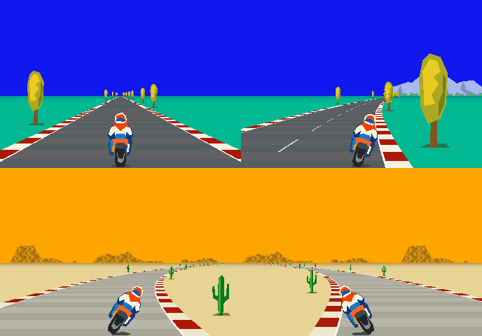

# Spectrum Attribute Racer

Two motorcycle circuits for the ZX Spectrum 128K. The camera follows the bike from behind. Steer to move the road under the tyres, watch for riders coming back into view over crests, and pass on either side. Speed is controlled entirely by Q and A during renderer testing. Crossing the verge or touching another rider preserves both gear and speed. Each clean overtake adds one to the dashboard counter.

| Circuit | Ride | Emulator capture |
| --- | --- | --- |
| [Coast Run](play/coast-run.tap) | Climb the headland past the beacons, drop into a hooked ravine, then cross the low causeway before the paired summit bends. | [Watch a bend](docs/coast-run.gif) |
| [Ridge Run](play/ridge-run.tap) | Follow the pines into a steep switchback climb. The road disappears over a blind summit, opens into a downhill S-bend and climbs a second ridge. | [Watch a bend](docs/ridge-run.gif) |


## Play

Open either TAP with tape autoload on a 128K Spectrum, +2 or +2A emulator. Enable mid-frame shadow-screen switching (Real Video in ZEsarUX). Both rides start in second gear.

| Keys | Action |
| --- | --- |
| O / P | Move left / right at one lane unit per 50 Hz tick in every gear. Release to hold your position through bends. Pressing both keys also holds position. |
| Q / A | Shift up / down through four gears |

## Flat-road Python prototype

Double-click `Preview-Road.bat` or run `python tools/preview_flat.py`. This is the PC-only Hang-On appearance study. Choose one of four camera positions drawn from the supplied references. Each opens paused. Space starts or stops travel, O/P or the arrow keys move directly across the road, and the Lap slider scrubs the circuit. Toggle Rider to inspect the kerbs. The Speed slider changes the distance travelled per second.

The horizon is fixed. A flat-plane perspective projection sets the width and depth of every scanline. The renderer integrates the curvature of the upcoming track relative to the camera heading. Paint and roadside objects use the same distance as the road. Edit `tools/flat_road.py` to tune the track, camera and colours. The comparison below shows the opening straight and coastal right above the desert right and left.



## Previous Spectrum road reference

Run `python tools/preview_road.py` with Python and Tkinter. The left panel draws the floating-point road one scanline at a time at fractional course positions. The right panel shows the geometry the Z80 can draw from the same course, including its two-pixel endpoint grid and integer course positions. Both panels show road paint only. The TAP adds scenery, riders and the timed screen effects.

Uncheck **Run** or press Space to freeze the road. Scrub **Track position** to inspect a bend, then drag **Lane** or hold O/P to move across it. Select either course and any of the four gears. The PC playback rate follows the selected gear's distance increment. Emulator captures measure the actual Z80 frame cadence.

## Build and test

Run these commands from the checkout with Python 3.10 or later. The build uses SjASMPlus. The headless tests use ZEsarUX. On the original Windows development machine both commands find the same installations as the shmup.

```powershell
python tools/build.py
python tools/verify.py
```

Both commands accept `--course coast` or `--course ridge`. The verifier also accepts `--model 128k`, `--model P2` or `--model P2A41`. Set `SJASMPLUS` and `ZESARUX` to the tool paths if needed, or pass `--assembler <path>` and `--emulator <path>` respectively. The build writes a TAP, an instant-start SNA and a symbol map for each circuit in `build/` (Coast Run) and `build/ridge/` (Ridge Run). On Windows, `Build-TAP.bat` also rebuilds both.

## How the road works

The starting point was the shmup's Ringo-8/Blokius renderer. An interrupt synchronises the frame, and scheduled writes to `#7FFD` let the ULA fetch colours from either screen. The racer has its own raster loop, course compiler and sprite compositor. [Shmup source and timing measurements](https://github.com/johnparker007/SpectrumAttributeShmup/blob/b9f0878/docs/timing-baseline.md)

* The Python reference integrates the course's curvature and elevation, then fits a cubic across the visible road from the horizon to the tyres. The near and far handles follow different look-ahead distances. Elevation controls which road surface is visible on each scanline. Width, kerb paint and lateral camera offset are evaluated in floating point.
* The build samples the reference at 256 positions around each circuit. It stores shared endpoints for each eight-scanline section to half-pixel precision, plus depth, paint widths and lookup tables for the compiled slopes. The Z80 applies the steering offset, rounds each endpoint to the two-pixel grid and rasterises the taper between endpoints. The same camera drives the kerbs, centreline and roadside scenery.
* Bright bands show white paint on black. Normal-intensity bands show red kerbs on blue. A single two-pixel white centreline appears in the bright foreground bands. Road paint has priority where a roadside object shares its colour cell.
* The Z80 prepares the next bend in spare RAM. In the bottom 32 road scanlines it also draws an intermediate position of the kerbs and centreline. The top of that section stays joined to the existing bend. The patch preserves the rider and roadside colour cells, and a full update restores every touched bitmap block.
* The colour bands scroll at 50 Hz. Each new road view samples the current lateral position directly. Run `python tools/measure_motion.py --course coast --input right` to measure the actual pixel steps and hold times at the bottom of the screen. Both courses support `right` and `none` input fixtures.

Edit the elevation and curvature in [tools/route.py](tools/route.py), the master road shape in [tools/road_model.py](tools/road_model.py), the Spectrum sampling in [tools/kerbs.py](tools/kerbs.py), the compiled paint shapes in [tools/strokes.py](tools/strokes.py), and the native renderer in [src/racer.asm](src/racer.asm).

## Timing and picture checks

The verifier steers through a full lap of each course in ZEsarUX and captures every 50 Hz display frame. It independently draws the expected kerbs, centreline, roadside objects and rider for the camera and stripe phase that the game published. It compares every pixel of all 120 road scanlines in sequence, including frames held between camera updates. It runs a second full lap from the playable TAP through the ROM loader, using the default starting gear and scripted steering.

At five lane positions the verifier measures all four painted kerb boundaries against the floating-point model on every visible scanline over a lap. The allowed maximum error is three Spectrum pixels. An additional offline check covers all 256 positions and all 241 steering settings on each circuit. Three motion regressions track a kerb across five consecutive positions on bends that previously snapped sideways. The verifier also decodes the compiled kerb and centreline shapes and checks the paint on each scanline. With steering held constant, an endpoint can move at most four pixels between consecutive course positions. The emulator checks the keyboard, overtakes, contact, interrupt deadlines and 228-T-state spacing between screen selections on the 128K, grey +2 and +2A.
