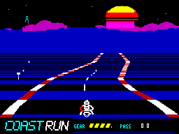

# Coast Run

A playable ZX Spectrum 128K motorcycle racer. Follow the flat coast road, countersteer through the bends and pass the other rider. Contact or running wide drops the bike to first gear. Each clean overtake adds one to the dashboard counter.



## Play

Open [coast-run.tap](play/coast-run.tap) with tape autoload on a 128K Spectrum, +2 or +2A emulator. The bike starts rolling in second gear. Use an emulator with mid-frame shadow-screen switching enabled. In ZEsarUX this is Real Video.

| Keys | Action |
| --- | --- |
| O / P | Steer and lean left / right |
| Q / A | Shift up / down through four gears |

## Build and test

Run these from the checkout with Python 3.10 or later. The build uses SjASMPlus. The headless tests use ZEsarUX. On the original Windows development machine both commands find the same installations as the shmup.

```powershell
python tools/build.py
python tools/verify.py
```

Elsewhere pass `--assembler <path>` to the build and `--emulator <path>` to the verifier, or set `SJASMPLUS` and `ZESARUX`. The build produces `build/coast-run.tap`, an instant-start `build/coast-run.sna` and a symbol map. On Windows, `Build-TAP.bat` also rebuilds the playable image. To run one model, use e.g. `python tools/verify.py --model 128k`.

## How the road works

The starting point was the shmup's Ringo-8/Blokius renderer. Its interrupt synchronises the frame and its scheduled writes to `#7FFD` let the ULA fetch colours from either screen. Coast Run has its own raster loop, course compiler and sprite compositor. [Shmup source and timing measurements](https://github.com/johnparker007/SpectrumAttributeShmup/blob/b9f0878/docs/timing-baseline.md)

* Screen banks 5 and 7 carry the same road bitmap and different attributes for grass, kerbs and lane paint. Once per road scanline, in the horizontal border, the Z80 selects the screen for the upcoming line. An inverse-depth table chooses the bank for each of 104 lines. Changing its phase each frame sends tightly spaced stripes at the horizon into broad foreground bands.
* A 64-step looping course moves the vanishing point, projects bollards and chevron boards, and brings a slower motorcycle down each side in turn. Bends and objects update in batches of 24 changed tiles. The stripe motion and the player's lean run at the 50 Hz display rate. The current build has one course with a level horizon.
* The rider saves the track underneath its 24×24 masked bitmap. Once the beam passes the bike, the game restores the background, reads the keyboard and stages the next tile batch from one of five data banks. After the next IM 2 interrupt, the fixed-duration blits finish before active display and the raster starts from the same timing window.

The Z80 program is in [src/racer.asm](src/racer.asm). Change the projection, scenery, riders and palette in [tools/course.py](tools/course.py).

## Timing checks

The verifier runs the release TAP through the ROM loader with null video and audio drivers, then compares real-video captures against expected Spectrum pixels. Snapshot runs separately trace every road paging instruction, exercise the keyboard, cover a full lap in top gear and check clean passes and contact.

Measured with SjASMPlus 1.20.2 and ZEsarUX 10.3 on the 128K, grey +2 and +2A models. All three kept 228 T-states between successive road latches and completed the lap without missing an interrupt. The first latch fell between T-states 28,924 and 28,927 relative to frame start. Timing has been checked in emulation only.
